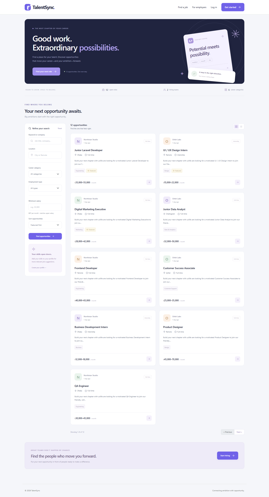
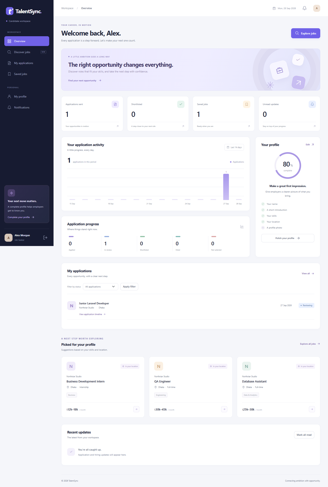
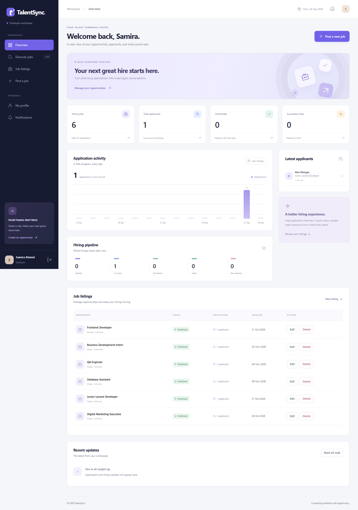
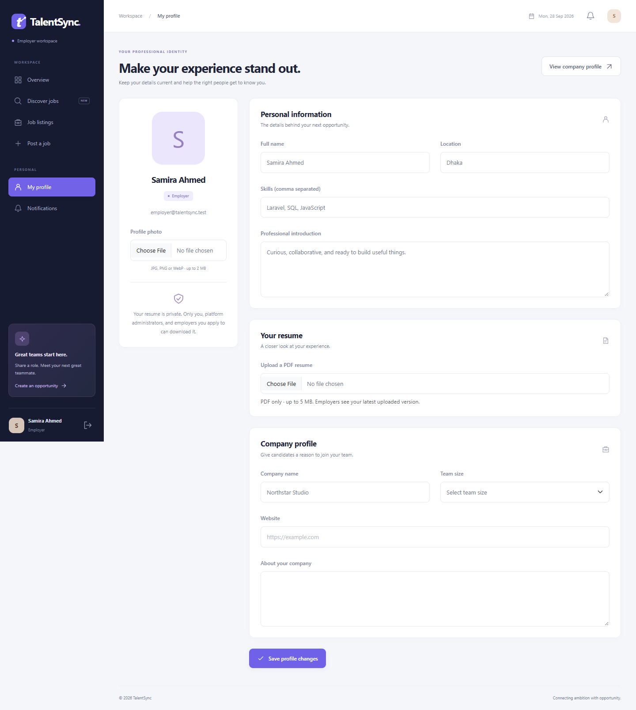
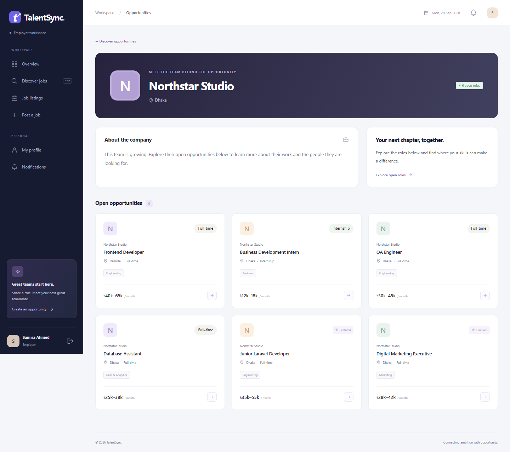
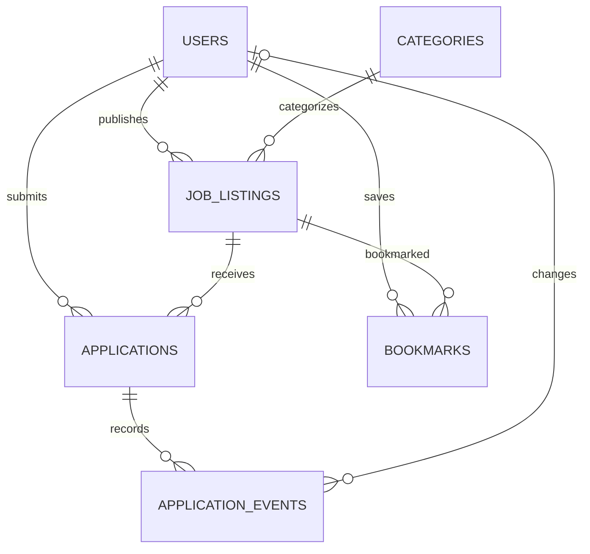

# TalentSync

### A Laravel recruitment platform connecting talent with opportunity.

TalentSync brings job discovery, applications, employer hiring workflows, and platform administration into one application. Candidates can build a profile, save opportunities, upload a private resume, and track application progress. Employers can publish jobs, present their company, and manage applicants.



## Explore the experience

| Candidate workspace | Employer workspace |
|---|---|
|  |  |

| Professional profiles | Company profiles |
|---|---|
|  |  |

## Features

- **Job discovery:** keyword/company search, location, category, employment type and salary filters, sorting, pagination, and grid/list views.
- **Candidate workspace:** application metrics, activity chart, saved opportunities, profile completion, and explained skill/location-based job suggestions.
- **Employer workspace:** create, edit, publish, draft, close and delete listings; search applicants and manage their application status.
- **Professional profiles:** avatar, skills, introduction, location, and private PDF resume upload, replacement and removal.
- **Company profiles:** company introduction, website, team size and open opportunities.
- **Application tracking:** one-click applications, duplicate prevention and persisted status history.
- **Access control:** Spatie permissions for Job Seeker, Employer, Admin and Super Admin; employer ownership checks and a Super Admin authorization override.
- **Admin tools:** searchable users, role and job-status filters, featured jobs, application oversight and role assignment.
- **Rich-text descriptions:** locally bundled CKEditor with server-side HTML sanitization.
- **Notifications:** queued email, stored dashboard notifications and configurable private-channel Pusher alerts.

## Technology

| Layer | Technologies |
|---|---|
| Backend | PHP 8.2+, Laravel 12, Eloquent |
| Frontend | Blade, Bootstrap 5, custom CSS, JavaScript, CKEditor 5 |
| Authorization | Spatie Laravel Permission, Laravel Gates |
| Database | MySQL configuration; SQLite local demo and automated tests |
| Notifications | Laravel queues, mail, database notifications, Echo + Pusher integration |
| Testing | PHPUnit feature/integration tests and browser checks |

## Database design



Applications and bookmarks have unique user/job pairs. Foreign keys protect domain relationships and cascade dependent records when a job is deleted. Application status updates run in a transaction and record history. Resume files are stored privately; authenticated downloads are limited to the owner, administrators, and employers the candidate has applied to.

See [architecture and database notes](docs/ARCHITECTURE.md) and [SQL examples](docs/queries.sql).

## Run locally

### Requirements

PHP 8.2+, Composer, and MySQL. Enable the PHP extensions required by Laravel, plus PDO MySQL, mbstring, fileinfo, openssl, curl and zip. Node.js is only needed to rebuild frontend editor assets; compiled assets are included.

1. Download or clone this repository and open a terminal inside its folder.
2. Install dependencies:

```sh
composer install
```

3. Copy `.env.example` to `.env` (Windows: `copy .env.example .env`; macOS/Linux: `cp .env.example .env`).
4. Create a database:

```sql
CREATE DATABASE talentsync CHARACTER SET utf8mb4 COLLATE utf8mb4_unicode_ci;
```

5. Set your MySQL credentials in `.env`, then run:

```sh
php artisan key:generate
php artisan migrate --seed
php artisan storage:link
php artisan serve
```

6. Open `http://127.0.0.1:8000`. In a second terminal, run:

```sh
php artisan queue:work --tries=3
```

For a SQLite demo, create `database/database.sqlite`, set `DB_CONNECTION=sqlite` and set `DB_DATABASE` to the absolute file path before migrating. Do not use `migrate:fresh` on a database containing data you want to keep.

### Local demo accounts

The seeder creates these local demonstration accounts. Each uses **TalentSync123!**.

| Role | Email |
|---|---|
| Job Seeker | seeker@talentsync.test |
| Employer | employer@talentsync.test |
| Second Employer | employer2@talentsync.test |
| Admin | admin@talentsync.test |
| Super Admin | super@talentsync.test |

Demo records include twelve jobs and six categories. Listing deadlines are relative to their first seed date. Existing records are preserved when seeding again.

### Mail and live notifications

The default `MAIL_MAILER=log` writes email content to `storage/logs/laravel.log` after the worker runs; it does not deliver to a real inbox. Configure SMTP settings and a verified sender to send actual email.

For live notifications, configure `BROADCAST_CONNECTION=pusher` and the `PUSHER_APP_*` environment variables. Echo listens on an authenticated private user channel. Without Pusher, stored notifications remain available after refreshing the dashboard.

Never commit `.env`, credentials, user uploads, or a populated local database.

## Project structure

```text
app/Http/Controllers/   Request validation, authorization and workflows
app/Models/             Eloquent models and relationships
app/Notifications/      Queued notification channels
app/Providers/          Authorization gates
routes/                 Web routes and private broadcast channels
resources/views/        Blade interface
public/css/             Interface styles
public/vendor/          Bundled browser dependencies
database/migrations/   Versioned schema changes
database/seeders/      Roles, permissions and demo data
tests/Feature/          Workflow, integrity and access-control tests
docs/                   Screenshots, SQL and design notes
```

## Verification

```sh
php artisan test
php artisan view:cache
```

The current test set covers authentication, role escalation protection, employer ownership, duplicate applications, HTML sanitization, filters, status history, private resume access, uploads, company profiles and admin filtering. The 26 tests passed, with the two corrected admin checks rerun after a template fix. Browser checks covered key desktop/mobile workflows, with no JavaScript errors or horizontal mobile overflow on the checked pages.

See [verification notes](docs/TESTING.md) for details and environmental limitations.

## Scope and limitations

- This repository is a working local application, not a production deployment.
- MySQL setup is supplied; automated execution here used SQLite. MySQL integration still needs verification.
- Real SMTP delivery and live Pusher delivery have not been verified with service credentials.
- Suggestions use transparent rules over the latest 100 open jobs, not an AI model.
- Company details belong to one employer account; shared recruiter teams are not implemented.
- Employers download a candidate's latest resume, not a historical application attachment.
- Password recovery, email verification, deployment automation and operational monitoring are future improvements.

## Frontend development

```sh
npm ci
npm run build:editor
```

## License

GPL-2.0-or-later. The application uses the GPL edition of CKEditor. See [LICENSE](LICENSE) and [third-party notices](THIRD-PARTY.md).

