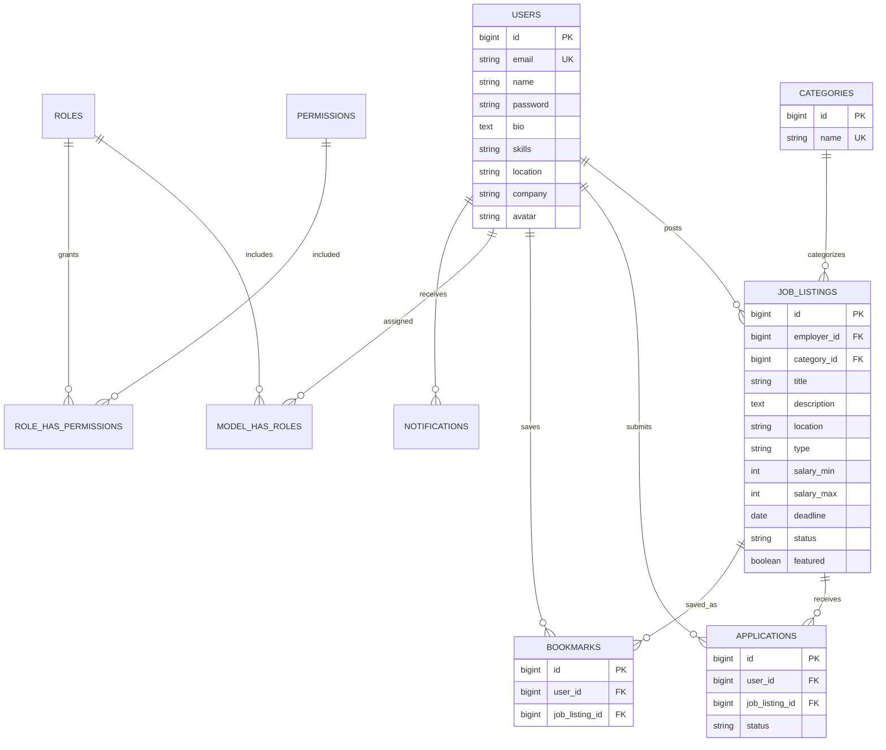

# Architecture and Database Design

## Objective

Connect employers and job seekers while demonstrating CRUD, joins, constraints, transactions, indexes and role-based authorization.

## Entity relationships

Spatie's model_has_roles and model_has_permissions use polymorphic model IDs, not physical foreign keys to users. Notifications uses the same polymorphic approach. These are logical user relationships in the diagram. Roles and permissions use the web guard. Framework infrastructure tables include sessions, cache, jobs, job_batches, failed_jobs and password_reset_tokens.

## Data dictionary

Domain tables include created_at and updated_at. IDs are generated primary keys.

| Table | Important columns | Purpose / constraints |
|---|---|---|
| users | email, name, password, bio, skills, location, company, avatar | Unique email; hashed password; optional profile attributes |
| categories | name | Unique category name |
| job_listings | employer_id, category_id, title, description, location, type, salary_min/max, deadline, status, featured | Employer/category foreign keys; integer BDT/month salaries |
| applications | user_id, job_listing_id, status | Unique user/job pair prevents duplicate applications |
| bookmarks | user_id, job_listing_id | Unique user/job pair prevents duplicate saved jobs |
| roles, permissions | name, guard_name | Spatie role/permission identity |
| role_has_permissions | role_id, permission_id | Composite key resolves many-to-many grants |
| model_has_roles, model_has_permissions | model_type, model_id, role_id or permission_id | Polymorphic role and direct-permission assignments |
| notifications | UUID id, type, notifiable_type/id, data, read_at | Payload and read state |

Deleting a user cascades to their jobs, applications and bookmarks. Deleting a job cascades to its applications and bookmarks. Deleting a category used by a job is restricted. Deletions are permanent and the interface asks for confirmation.

## Normalization and tradeoffs

Categories are stored once and referenced. Employer/company details stay on users rather than being repeated in every job. Applications and bookmarks resolve separate many-to-many user/job relationships. Each application has its own status.

Core entities avoid repeated groups and transitive dependencies. Skills is deliberately display text, not a searchable relation. If skill filtering is added, introduce skills and user_skills tables. Company is a profile attribute; multi-recruiter companies would need a separate companies table. Notifications use a flexible JSON-encoded text payload for different message types.

## Integrity and performance

- Primary keys identify records; foreign keys enforce domain relationships.
- Unique application/bookmark pairs protect integrity even when a request is repeated.
- A status/deadline index supports open-job queries. A category/type index supports filtering.
- Allowed statuses, salary order and deadlines are validated in Laravel, not database CHECK constraints. Direct SQL writes must respect these rules.
- Application creation and notification scheduling run in a transaction. Queued notifications wait for commit.
- Eager loading retrieves related employer/category data without one extra query per listing.
- LIKE searches are suitable for this small course project; larger systems would need a search index.

## Request flow

1. Browser requests GET /?category=1.
2. routes/web.php dispatches to JobController::index.
3. Controller validates the filters and builds an Eloquent query.
4. JobListing retrieves rows plus related employers/categories.
5. Controller passes results to jobs/index.blade.php.
6. Blade renders HTML for the browser.

POST /jobs/2/apply passes authentication and CSRF checks. ApplicationController checks permission and job availability, creates a unique application inside a transaction, and queues a notification. It redirects with a success message. A queue worker processes the mail/database/optional broadcast channels.

## Permissions

| Action | Guest | Job Seeker | Employer | Admin | Super Admin |
|---|---|---|---|---|---|
| Browse open jobs | Yes | Yes | Yes | Yes | Yes |
| Edit own profile | No | Yes | Yes | Yes | Yes |
| Apply / save | No | Yes | No | No | Yes |
| Create listing | No | No | Yes | Yes | Yes |
| Edit jobs / applicants | No | No | Own | All | All |
| Manage users / feature jobs | No | No | No | Yes, except protected super accounts | Yes |
| Assign roles | No | No | No | No | Yes |

Super Admin bypasses Gate authorization, but not validation, database integrity, applying to its own job, or safeguards against deleting/demoting its own account.

## Application status history

The upgrade adds application_events: id, application_id (foreign key, cascade delete), actor_id (nullable user foreign key, null on delete), status, and timestamps. One application has many events; a user may act on many events. Status changes lock the application row inside the transaction and record the new status only when it changes. The migration creates a baseline event for existing records without inventing earlier history.

## Professional profile fields

The users table now includes resume (private storage path), company_description, company_website and company_size. Resume contents are stored on disk rather than as a database blob. The database keeps the path; authenticated controller authorization protects downloads. Company details belong to the employer account in this implementation.
